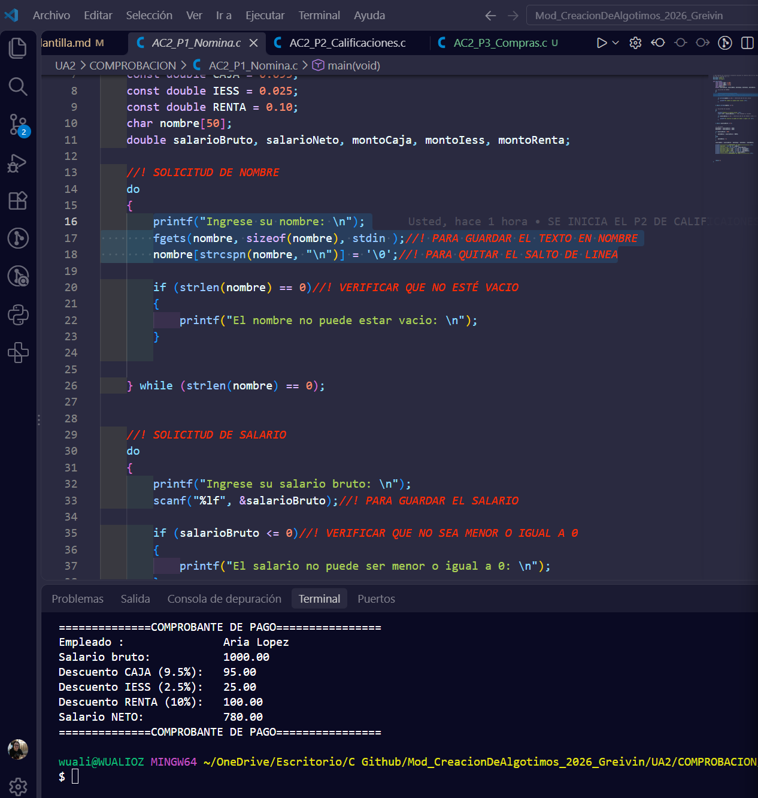
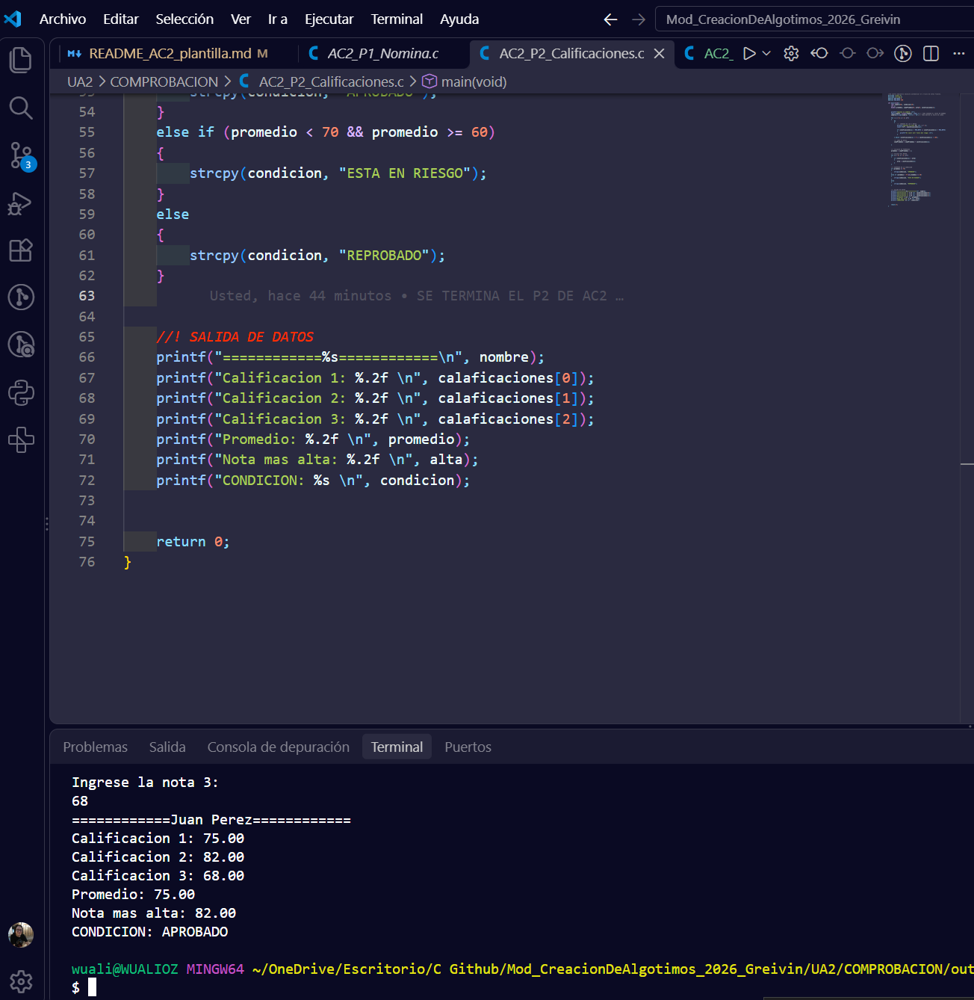

# AC2 · Mi primera aplicación en C

**Estudiante:** Greivin Montero Contreras  
**Fecha:** 20/10/2026  
**Módulo:** CSTI12010 Diseño de algoritmos · UA2

## Problema 1 · Nómina (AC2_P1_Nomina.c)

| Datos de entrada | Proceso | Datos de salida | Limitaciones |
| ---------------- | ------- | --------------- | ------------ |
| *Nombre del Empleado y Salario*                 | *Se valida salario se hacen los calculos y se procede a mostrar los montos de cada deduccion*        |*Salario bruto, salario neto y deducciones.*                 | *Numeros negativos, texto en vez de numeros y nombre vacio*             |

**Ejecución con los datos del ejemplo:**

## Problema 2 · Calificaciones (AC2_P2_Calificaciones.c)

| Datos de entrada | Proceso | Datos de salida | Limitaciones |
| ---------------- | ------- | --------------- | ------------ |
| *Nombre y 3 calificaciones*                 | *Validar nombre y notas, sacar el promedio, identificar la nota mayor, crear condicion para el estudiante y mostrar en pantalla*       | *promedio, nota mayor, condicion, nombre, notas*                | *Solo un estudiante, valores incorrectos para validar como fuera del rango*             |

**Ejecución con los datos del ejemplo:**

## Problema 3 · Compras (AC2_P3_Compras.c)

| Datos de entrada | Proceso | Datos de salida | Limitaciones |
| ---------------- | ------- | --------------- | ------------ |
|                  |         |                 |              |

**Ejecución con los datos del ejemplo:**

## Conclusión

(Qué aprendí y qué fue lo más difícil de pasar de PSeInt a C.)
